<p align="center">
  <picture>
    <source media="(prefers-color-scheme: dark)" srcset="docs/brand/readme/hero-dark.svg">
    
  </picture>
</p>

<p align="center">
  <b>bise</b> /beez/ · french, n.<br>
  1. a quick kiss on the cheek :*<br>
  2. a brisk north wind<br>
  3. a team lead for your coding agents, in a Mac app or in your terminal
</p>

<p align="center">
  <a href="https://bise.dev">bise.dev</a> ·
  <a href="#install">install</a> ·
  <a href="https://bise.dev/docs/">docs</a> ·
  <a href="#how-its-built">how it's built</a> ·
  <a href="#features">features</a>
</p>

<br>

bise runs several coding agents for you behind one lead agent.

you talk to one agent, the lead (`main`). it splits what you ask into tasks, does the small ones itself, and starts an agent per task when one is needed. the agents work in parallel, tell each other before they touch the same files, and get their own git worktree when they need a separate copy. what needs your decision (an approval, a choice between options, a review) waits in an inbox; the rest doesn't interrupt you.

one lead, one agent per task, one inbox. there is no workflow to configure.

<p align="center">
  <picture>
    <source media="(prefers-color-scheme: dark)" srcset="docs/brand/readme/demo-b-desktop-dark.svg">
    
  </picture>
</p>

## two front ends, one engine

|  | bise desktop | bise terminal |
|---|---|---|
| what | a macOS app: every project in one window, an inbox, notifications, hold fn to talk from any app | a terminal UI: one thread per repo, keyboard first, works over SSH |
| runs on | macOS 14 or later, Apple silicon | macOS (Apple silicon and Intel), Linux x86_64 and arm64 (glibc 2.34+) |
| install | [download on bise.dev](https://bise.dev) | `curl -fsSL bise.dev/install \| sh` |

both are clients of the same local hub: the same projects, agents, threads, keys and settings. you can use one, or both at once on the same repo. voice and computer use are macOS only.

## install

**bise desktop**: download it on [bise.dev](https://bise.dev), drag it to Applications, open it. it updates itself.

**bise terminal**:

```sh
curl -fsSL bise.dev/install | sh
cd ~/your-repo
bise
```

the first run asks for a theme and a model. `bise doctor` checks the install, your keys and the running hubs. Linux: see [install](https://bise.dev/docs/install) for the supported distributions; NixOS: [the flake](docs/nixos.md).

coming from Claude Code or Codex? paste this into it:

```text
read https://bise.dev/setup.md and set bise up for me
```

it installs bise and brings over your API key, your model, your `CLAUDE.md`, your skills and your MCP servers. it shows you one plan and waits for your yes; it never prints a key.

## models and plans

bise is free and open source. you pay for the models, with a key or a plan you already have:

- **API keys**: Anthropic, OpenAI, Google AI Studio, Mistral, OpenRouter, Groq, xAI, DeepSeek, Together AI, Fireworks AI, Cerebras; local models through Ollama or LM Studio; any OpenAI-compatible endpoint or gateway ([custom providers](docs/custom-providers.md)). see [providers](https://bise.dev/docs/providers).
- **plans**: ChatGPT Plus or Pro (`bise login chatgpt`), OpenRouter sign-in, GLM Coding Plan, Kimi Code, MiniMax M plan. a Claude Pro or Max plan only runs in Anthropic's apps; Max and Team include monthly API credits that work here through an Anthropic key. see [subscriptions](https://bise.dev/docs/subscriptions).

each agent can use its own model and reasoning effort (`/model`, `/reasoning`).

## how it works

- **one thread per project.** you always talk to the same lead. when the thread gets long, it is compacted and goes on; any agent can search the full history.
- **the lead routes.** for each message it decides: answer it, hand it to an agent already on that work, start a new agent, or order it after another task.
- **agents work in the background,** in your checkout. they message each other before touching the same files. one makes a git worktree only when it needs its own copy, and removes it after.
- **the inbox** holds what needs you: approvals, questions with options, merges. an item can open the page the agent wrote, where you leave notes on the work and pick an option.
- **approvals**: by default commands run without asking (yolo). `shift+tab` switches to auto: safe commands run, risky ones wait for you (sandboxed on macOS).

## how it's built

- **the hub** keeps the state of every agent and message on your machine. its core, sb-core (message delivery, the inbox, wakes and timers, routing), is written in [Bend](https://github.com/HigherOrderCO/Bend) with checked laws and proofs: no message lost or delivered twice, a restart rebuilds the same state, nothing waits forever (`bend/laws/`, `bend/proofs/`).
- **the agent runtime** (`bend/runtime/`) runs each agent's loop; agents write small TypeScript scripts to call several tools in one step.
- **the terminal UI, the harness, providers and plugins** are in Rust (`rust/`).
- **the desktop app** (`apps/desktop/`) is an Electron app, a client of the same hub.
- **plugins** use the [Agent Plugins](https://agent-plugins.org) format: skills, MCP servers (local, or remote with OAuth) and hooks, from `~/.agents/plugins` or your repo.
- **restart-safe**: quit or update mid-task; agents resume where they stopped, with your draft and queued messages.

## features

### orchestration

#### long-running goals

give main a large goal. it splits it into jobs, runs agents in parallel, restarts any that stop on an error, and keeps going until the goal is done.

<picture><source media="(prefers-color-scheme: dark)" srcset="docs/brand/readme/feat/resume-desktop-dark.svg"></picture>

#### automatic worktrees

agents share your checkout by default. when one needs an isolated copy (a clean build, a risky change), it creates a git worktree, works there, and removes it when it's done. no branches to name, no folders to clean up. `ψ` marks an agent that works in its own worktree, in both apps.

<picture><source media="(prefers-color-scheme: dark)" srcset="docs/brand/readme/feat/worktree-desktop-dark.svg"></picture>

### focus

#### main is always available

main hands the heavy work to agents, so it's never busy. ask it anything while five agents run: it listens and answers right away, and nothing you send interrupts a job.

<picture><source media="(prefers-color-scheme: dark)" srcset="docs/brand/readme/feat/talk-desktop-dark.svg"></picture>

#### zen mode

in the terminal, while you type, the agents panel, the counters and the agents' chatter dim. they come back when you send. messages between agents stay folded; `ctrl+o` expands them.

<picture><source media="(prefers-color-scheme: dark)" srcset="docs/brand/readme/feat/zen-dark.svg"></picture>

### voice

#### voice to voice

in the desktop app, hold `fn` in any app and talk. bise takes a still of the window you're on, and the answer shows in a small card in the screen's corner, then stays in main's thread. in the terminal, press `ctrl+r` twice for voice mode: main answers out loud while the agents keep working. `space` sends right away, `esc` leaves, and `/voice` picks the model, the voice and the language.

<picture><source media="(prefers-color-scheme: dark)" srcset="docs/brand/readme/feat/voicemode-desktop-dark.svg"></picture>

#### dictation

press `ctrl+r` and talk: your words land in the composer, and any key stops it. in the desktop app it works from anywhere in the window.

<picture><source media="(prefers-color-scheme: dark)" srcset="docs/brand/readme/feat/voice-desktop-dark.svg"></picture>

### coordination

#### main answers routine questions

agents ask main, not you. main answers what it can, the way you would, and says why. only the decisions that are yours reach your inbox.

<picture><source media="(prefers-color-scheme: dark)" srcset="docs/brand/readme/feat/card-desktop-dark.svg"></picture>

#### agent-to-agent messages

agents message each other directly: questions, hand-offs, who edits which file. these messages are folded in your thread.

<picture><source media="(prefers-color-scheme: dark)" srcset="docs/brand/readme/feat/sync-desktop-dark.svg"></picture>

### tools

#### every MCP server, always enabled

connect as many MCP servers as you want (GitHub, Linear, Sentry, Slack, your database) and keep them all on. agents call tools from code, so a hundred servers don't fill the context. the plugins place in the app, or `/plugins` in the terminal, lists them with their state.

<picture><source media="(prefers-color-scheme: dark)" srcset="docs/brand/readme/feat/tools-desktop-dark.svg"></picture>

#### computer use

your agents can use your browser: they open pages in their own tab group, in the background, with your logins, and read, click, type, fill forms and take screenshots. they never take your screen or your active tab. on macOS they can drive apps like Notes or Figma too. it's off by default: `/computer-use` sets it up (the Chrome extension, the permissions, a live test). for now it acts without asking first, so give it the jobs you'd give someone at your desk.

<picture><source media="(prefers-color-scheme: dark)" srcset="docs/brand/readme/feat/computer-dark.svg"></picture>

#### Agent Plugins

skills, MCP servers and hooks in the [Agent Plugins](https://agent-plugins.org) format load as they are, from `~/.agents/plugins` or your repo. Vibe plugins too. in the app, each plugin has its page in the plugins place, with a few lines to try.

<picture><source media="(prefers-color-scheme: dark)" srcset="docs/brand/readme/feat/plugins-desktop-dark.svg"></picture>

### control

#### talk to any agent

`⌥` + a number talks to one agent directly; in the desktop app a click on its row in the right bar does too, and in the terminal `@name`. ask it why, redirect it, then `esc` takes you back to main. the other agents keep running.

<picture><source media="(prefers-color-scheme: dark)" srcset="docs/brand/readme/feat/direct-desktop-dark.svg"></picture>

#### pull requests

in a repo that takes pull requests, each change gets its own branch and PR, and goes through your CI, review bots and teammates. the agent's row (the right bar in the app, the agents panel in the terminal) shows where its PR stands: checks, review, merged.

<picture><source media="(prefers-color-scheme: dark)" srcset="docs/brand/readme/feat/prs-desktop-dark.svg"></picture>

### what they made

#### artifacts

what agents make for you (a page, a doc, a sheet, slides, a PR) is an artifact: a ↗ chip in the thread, and one list with its versions (the artifacts screen in the app, `/artifacts` in the terminal). in the desktop app it opens beside the thread: select a line, leave a note, and send your notes to the agent that made it. in the terminal, `space` shows it in Quick Look and `@` puts one in your message.

<picture><source media="(prefers-color-scheme: dark)" srcset="docs/brand/readme/feat/artifacts-desktop-dark.svg"></picture>

#### diffs beside the thread

click `± 3 files` under an agent's work: its changes against main open beside the thread, file by file. select lines and type to ask the agent about them. in the terminal, `ctrl+g` opens them too, `tab` goes to the next file, `⏎` opens the line in your editor, and `/diff` picks any branch.

<picture><source media="(prefers-color-scheme: dark)" srcset="docs/brand/readme/feat/diff-desktop-dark.svg"></picture>

## details

#### agents only when needed

main does small jobs itself and starts an agent only when a job needs one. no agents reviewing each other in loops, so fewer tokens.

<picture><source media="(prefers-color-scheme: dark)" srcset="docs/brand/readme/feat/tokens-desktop-dark.svg"></picture>

#### images

paste a screenshot (`⌘V` in the app, `ctrl+v` in the terminal) or drag it in. it becomes one chip in your message.

<picture><source media="(prefers-color-scheme: dark)" srcset="docs/brand/readme/feat/screenshot-desktop-dark.svg"></picture>

#### quotes

select text in the thread and start typing: it's attached to your message as a quote.

<picture><source media="(prefers-color-scheme: dark)" srcset="docs/brand/readme/feat/quote-desktop-dark.svg"></picture>

#### a model per agent

a large model for the hard job, a fast one for chores. the composer's model menu in the app, `/model` and `/reasoning` in the terminal, set them per agent.

<picture><source media="(prefers-color-scheme: dark)" srcset="docs/brand/readme/feat/model-desktop-dark.svg"></picture>

#### scheduled tasks

agents can wake themselves on a schedule: check the build every 2 minutes, ship a release every morning. the app's right bar shows them under scheduled & watching; in the terminal, `/scheduled` lists them, `r` runs one now, `x` stops it.

<picture><source media="(prefers-color-scheme: dark)" srcset="docs/brand/readme/feat/scheduled-desktop-dark.svg"></picture>

#### built-in shell

``ctrl+` `` opens a terminal in your repo. it keeps running while hidden.

<picture><source media="(prefers-color-scheme: dark)" srcset="docs/brand/readme/feat/shell-dark.svg"></picture>

#### restart-safe

update or quit mid-work. agents resume where they stopped, and your thread, your draft and your queued messages come back.

<picture><source media="(prefers-color-scheme: dark)" srcset="docs/brand/readme/feat/restart-dark.svg"></picture>

#### proven message passing

the hub that carries messages between agents is written in [Bend](https://github.com/HigherOrderCO/Bend), with checked proofs that no message is lost or delivered twice (`bend/PROOF.bend`).

<picture><source media="(prefers-color-scheme: dark)" srcset="docs/brand/readme/feat/proof-dark.svg"></picture>

#### your terminal's theme

bise uses your terminal's colors, light or dark, and keeps text at a reading width.

<picture><source media="(prefers-color-scheme: dark)" srcset="docs/brand/readme/feat/theme-dark.svg"></picture>

## from source

```sh
git clone https://github.com/gvergnaud/bise && cd bise
./run.sh    # builds and starts bise terminal in the current folder
```

## what's in here

- [`rust/`](rust/) · the terminal UI, the agent harness, providers, plugins, sessions
- [`bend/`](bend/) · sb-core (the hub's core) and the agent runtime, in [Bend](https://github.com/HigherOrderCO/Bend), with their laws (`bend/laws/`) and proofs (`bend/proofs/`)
- [`apps/desktop/`](apps/desktop/) · bise desktop, the macOS app
- [`prompts/`](prompts/) · the system prompts and tool descriptions the agents read
- [`site/`](site/) · [bise.dev](https://bise.dev) and its docs (the installer too)
- [`tests/`](tests/) · the gate (`gate.sh`), e2e and TUI tests
- [`scripts/`](scripts/), [`packaging/`](packaging/) · dev, build, install and release scripts
- [`docs/`](docs/) · design docs and notes; [`docs/brand/`](docs/brand/) the brand book and these images

## license

Apache-2.0, see [LICENSE](LICENSE). third-party components: [THIRD_PARTY_NOTICES](THIRD_PARTY_NOTICES).

<p align="center"><br>ideas in. little kisses out. also pull requests. :*</p>
